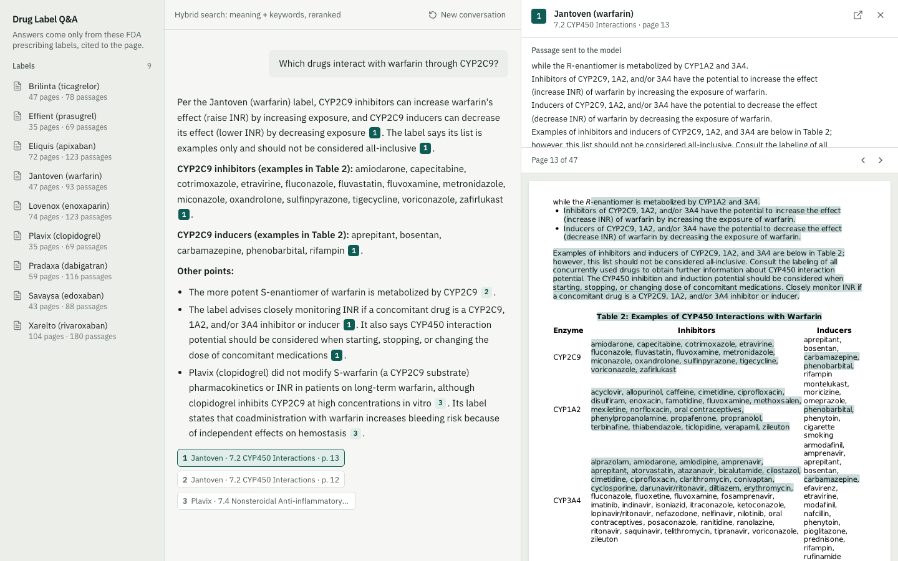
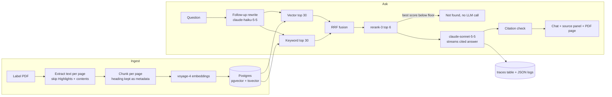
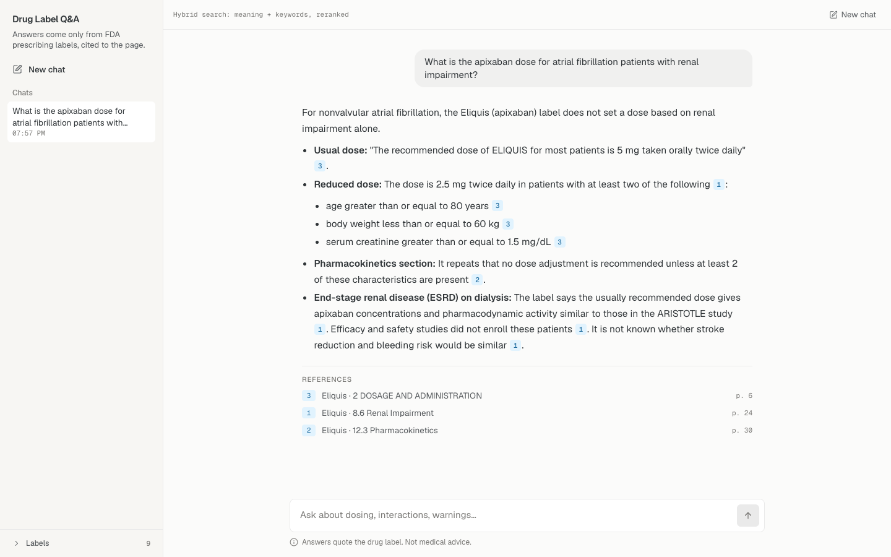

<!-- Yurii: every block marked "write this" holds facts only. Rewrite those sections in your own words, then delete all <!-- Yurii --> markers (grep "Yurii" must return nothing before you push). -->

# Drug Label Q&A

Ask questions about FDA prescribing labels and get answers that cite the label page they came from.
Seeded with 9 anticoagulant and antiplatelet labels from DailyMed; you can upload more PDFs.

No API keys at hand? The Loom video and the screenshots below show the full flow.



## Quick start

Requirements: Docker. An Anthropic API key. A Voyage AI key is optional.

```bash
cp .env.example .env    # set ANTHROPIC_API_KEY, optionally VOYAGE_API_KEY
docker compose up --build
```

Open http://localhost:3000. If port 3000 is taken: `APP_PORT=3100 docker compose up --build`.

First start runs migrations and loads the seed labels with precomputed embeddings (no Voyage calls).
Without `VOYAGE_API_KEY` the app runs keyword search only and shows a banner.

Local development (Node 24, pnpm):

```bash
docker compose up -d db
pnpm install
pnpm migrate && pnpm seed
pnpm dev
```

| Command | What it does |
|---|---|
| `pnpm test` | Unit tests (chunker, RRF fusion, citation check, prompt builder) |
| `pnpm eval` | Retrieval ablation + judged end-to-end answers, writes `evals/results.md` |
| `pnpm fetch-labels` | Downloads the pinned label PDFs from DailyMed |
| `pnpm build-seed` | Re-parses, chunks and embeds the seed labels into `data/seed/vectors.json` |

## Architecture



One Next.js app. `lib/rag/*` holds the pipeline as small functions (`pdf`, `chunk`, `embed`, `search`, `rrf`, `retrieve`, `prompt`, `citations`, `ingest`); the route handlers in `app/api/*` and the scripts in `scripts/*` call the same functions, so the eval runs the exact code the chat runs.

| Path | Role |
|---|---|
| `app/api/chat/route.ts` | Validates input, loads history, retrieves, streams the answer, writes `messages` + `traces` |
| `app/api/documents/*` | List, upload (PDF only, 20 MB), serve PDF bytes |
| `lib/rag/` | Parsing, chunking, embeddings, hybrid search, rerank, prompt, citation check |
| `lib/db/schema.ts` | `documents` (PDF as bytea), `chunks` (vector(1024) HNSW + generated tsvector GIN), `messages`, `traces` |
| `components/` | Chat, citation chips, source panel, react-pdf viewer |
| `evals/` | Golden set and latest results |

## RAG approach and decisions

<!-- Yurii: write this. Facts to build from: -->

**Use case and data**
- Option 1 (chat with docs) with pharma documents: Newpage's clients are pharma, biotech and healthcare.
- 9 FDA labels (Eliquis, Xarelto, Pradaxa, Savaysa, Jantoven, Lovenox, Plavix, Effient, Brilinta). Labels have numbered sections, so citations can name the section; interactions and renal dosing make hard questions.

**Language**
- TypeScript end to end. Draft line to keep in your own words: "I've used RAG inside Node, because it's my main language and the task is quite simple. For more complex tasks I'd use Python because of the richest library availability."

**Parsing and chunking**
- unpdf (pdf.js) text per page. Pages before the line "FULL PRESCRIBING INFORMATION" are blanked: the two-column Highlights block and the contents list extract as noise and repeat every heading.
- Chunks never cross a page, so a citation points to one page. New chunk at a numbered heading (sections 1-17 only, so "2.5 mg twice daily" or "18 Years of Age" are not headings) or at ~1800 chars, with a 2-line overlap.
- 939 chunks, ~900 chars average. The label title is stored on each chunk (`context`): label text says "ELIQUIS", users ask about "apixaban". The title goes into the embedding text and the keyword index.
- Considered: pure section splitting (breaks on the contents list and on non-label uploads), hosted parsers (cost, another key). Production path: DailyMed SPL XML, which has structured sections.

**Embeddings**
- Voyage `voyage-4`, 1024 dims (fits pgvector's 2000-dim HNSW cap), `input_type` query vs document, 32k context.
- Considered `voyage-4-lite` (same specs, cheaper, but free tier makes cost moot) and OpenAI `text-embedding-3-small` (1536 dims, 8k input, no reranker on the same key).
- No vendor publishes a pharma-label retrieval benchmark I could verify, so the eval set decides.

**Vector store**
- Postgres + pgvector: vectors, keyword index, chunks, chat history and traces in one database. Same thing runs on RDS / Cloud SQL / Azure Postgres.
- Considered Qdrant/Chroma (second store, weaker keyword search) and LanceDB (no server, weak multi-user story).

**Retrieval**
- Vector top 30 + Postgres full-text top 30 (OR of query terms, `ts_rank_cd`), fused with Reciprocal Rank Fusion (k=60), then Voyage `rerank-3` picks the top 6.
- Ablation (below): vector alone 100% hit@6 / MRR 0.78; hybrid without rerank 75% / 0.55; hybrid + rerank 100% / 0.96. The keyword leg alone adds noise on natural-language questions; the reranker is what makes hybrid pay off.

**LLM and orchestration**
- `claude-sonnet-5-5` answers, `claude-haiku-5-5` rewrites follow-ups and judges evals. Model ids live in one file (`lib/rag/models.ts`); any AI SDK provider fits there.
- Vercel AI SDK for streaming and provider swap; no RAG framework. Considered LangChain.js / LlamaIndex.TS: more abstraction than a pipeline this size needs.

**Prompt and context management**
- System prompt: answer only from numbered sources, cite `[n]` per sentence, exact not-found sentence when sources don't answer, quote numbers as written, treat source text as data.
- Sources go into the last user turn as `<source id label page section>` blocks; history stays plain text with old `[n]` marks stripped (each turn numbers its own sources).
- Last 6 turns kept. From turn 2, Haiku rewrites the question into a standalone search query ("and on dialysis?" becomes "apixaban dosing ... dialysis").

**Guardrails**
- Relevance floor: if the best rerank score is below 0.4, reply "not found" without calling the LLM. On the eval set in-scope questions scored 0.73 or higher, but one out-of-scope question scored 0.74, so the floor only catches clear misses; the prompt rule is the real guard (2 of 3 out-of-scope refusals came from it).
- Citation check: every `[n]` must point to a source that was sent; invalid ones are struck through in the UI. This proves the reference exists, not that it supports the claim.
- Personal treatment questions ("should my mother take 2.5 or 5 mg?"): the answer states the general label rule, does not apply it to the person, and defers to their clinician. First version applied the criteria to the mother; the prompt was tightened and the eval covers it.
- Input limits: question <= 1000 chars, PDF only (magic bytes), 20 MB, scanned PDFs rejected. Fixed disclaimer in the UI.

**Quality controls and evals**
- 15 hand-checked questions in `evals/golden.json`, each pinned to a label page I read: 10 answerable (one two-drug comparison), 3 out of scope, 2 patient-specific.
- `pnpm eval`: hit@6 and MRR per retrieval mode, then full answers judged by Haiku against the reference facts (structured pass/fail + reason), plus deterministic checks for refusals and citations. Latest: 15/15. See `evals/results.md`.

**Observability**
- pino JSON logs with request id and conversation id.
- `traces` table: question, rewritten search query, mode, retrieved chunk ids/pages/scores, model, input/output tokens, latency, outcome (`answered`, `not_found`, `answered_invalid_citations`).
- Considered Langfuse: its self-hosted setup adds several services to compose. OpenTelemetry / Langfuse is the production step.

## Key technical decisions

<!-- Yurii: write this. Facts to build from: -->
- One Next.js app instead of UI + separate API service: less plumbing for a 10-hour build; `lib/rag` is the seam to split along later.
- Docker image runs `next start` from a full install, not Next standalone output: standalone output skips files read at runtime (seed data, migrations). Bigger image, no tracing surprises.
- PDFs stored in Postgres (bytea): one volume holds all state.
- Precomputed seed embeddings committed (9.6 MB): first start needs no Voyage calls; Voyage limits keys without a payment method to 3 requests/min.
- Label PDFs committed with attribution (`data/seed/SOURCES.md`); copyright status not verified, so the README does not call them public domain.
- Follow-up rewrite with Haiku instead of embedding the whole conversation.

## Productionizing on AWS (or GCP / Azure)

<!-- Yurii: write this. Facts to build from: -->
- App: container on ECS Fargate or App Runner (GCP Cloud Run, Azure Container Apps); Next standalone output with explicit file includes.
- Database: RDS Postgres with pgvector (Cloud SQL / Azure Database for PostgreSQL both support it); migrations as a one-off release job, not on container start.
- Files: PDFs in S3 instead of bytea; signed URLs for the viewer.
- Ingest: upload to S3 -> SQS -> worker container (parse, chunk, embed), idempotent by document hash; status column for the UI.
- LLM: Claude via Amazon Bedrock (traffic and data stay in the AWS account); embeddings either kept on Voyage or moved to a Bedrock embedding model, chosen by re-running the same eval set.
- Secrets in Secrets Manager; private networking to the database.
- Auth: SSO (Cognito / Entra ID), per-tenant document access enforced in SQL (row-level security), audit log of every question and the sources shown.
- Observability: OpenTelemetry traces to CloudWatch/X-Ray or Langfuse; dashboards on latency, tokens, not-found rate, invalid-citation rate.
- Scale: HNSW is fine to millions of chunks; add metadata filters (label, section) and caching of query embeddings.
- Pharma specifics: label version tracking (SPL version per document, re-ingest on update), model and prompt version pinned per answer, validation evidence for GxP-style use.
- Rate limiting per user (not built here).

## Engineering standards

<!-- Yurii: write this. Facts to build from: -->
Followed:
- TypeScript strict, ESLint, Vitest; CI on push runs typecheck, lint, tests (`.github/workflows/ci.yml`).
- Input validated at the API boundary with zod; uploaded PDF text escaped before it reaches the PDF text layer.
- Small focused modules; pure functions unit-tested; comments only where the reason is not obvious; known shortcuts marked `shortcut:` with their limit.
- pnpm `minimumReleaseAge` of 1 day (supply-chain guard); lockfile committed.
- Clean-clone check: `git clone` + `docker compose up --build` on an empty database.

Skipped (and why):
- No E2E browser tests; UI checked by hand at 1440 and 390 px.
- No auth, no per-user rate limit (local demo).
- Evals not in CI: they need paid API keys as CI secrets.
- No integration test container for the search SQL; the eval exercises it against the real database.

## How I used AI tools

<!-- Yurii: write this in your own words. Facts to build from: -->
- Claude Code for scaffolding and most of the typing; I owned scope, architecture, review and every commit.
- Before coding: decisions settled in a Q&A round, then two independent critique passes (a sceptic and a reviewer) that cut the scope from ~18 h to ~10 h and changed the app from three services to one.
- Rules for the agent live in `AGENTS.md` (commands, AI SDK v7 pitfalls, test-first for `lib/rag`).
- Checks on generated code: typecheck/lint/tests on every commit, real-API probes before relying on a library (Voyage rerank-3 through the community provider), reading the real label text before writing the parser, the eval set before trusting retrieval.
- Things the AI got wrong and how they were caught: <!-- Yurii: pick real ones, e.g. the dosing answer that applied label criteria to a patient (caught by a manual test, fixed in the prompt, now an eval case); a React effect that returned the Promise from scrollIntoView (caught in the browser console); building the Docker image failed because env validation ran at build time (caught by a clean-clone build). -->
- Do's and don'ts: <!-- Yurii: your list. -->

## Known limits

- Tables flatten to text in extraction; cells lose their row/column meaning.
- Scanned (image-only) PDFs are rejected; no OCR.
- Keyword-only mode (no Voyage key) is noticeably weaker: it missed the Xarelto pre-surgery page that hybrid + rerank finds first.
- The in-PDF highlight matches text items against the passage, so table rows that share words with it can also light up.
- Prompt injection inside an uploaded PDF is mitigated by the prompt only (sources are treated as data); nothing strips instructions from documents.
- The relevance floor cannot separate all out-of-scope questions (score overlap shown above).
- No auth: anyone who can reach the app can upload and read all documents.

## What I'd do next

<!-- Yurii: write this. Facts to build from: -->
- Fix the keyword leg (AND first, OR fallback, or weight RRF) and re-run the ablation.
- Parse SPL XML instead of PDFs for exact sections and tables.
- Metadata filters (by label / section) and a compare-drugs view.
- Claim-level citation support check (does source [n] actually support the sentence).
- Bigger eval set from a pharmacist, plus eval runs in CI against a seeded database.
- Auth, rate limits, async ingest worker, S3 storage.

## Screenshots

| Start | Cited answer |
|---|---|
|  |  |
| **Source panel with the cited page** | **Out-of-scope question** |
|  |  |

## Data source

Label PDFs: National Library of Medicine, DailyMed. Versions and set ids in `data/seed/SOURCES.md`.
