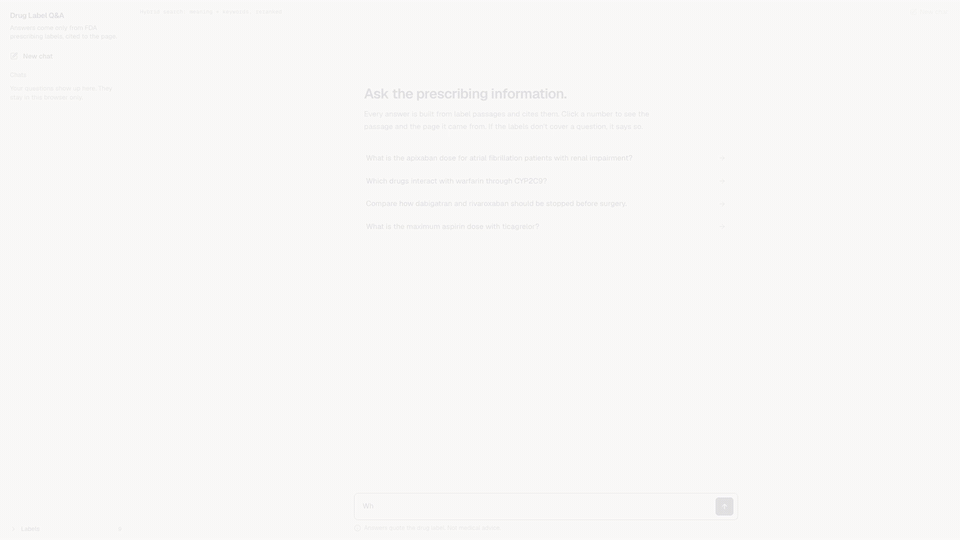
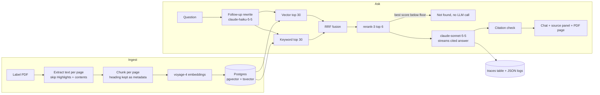
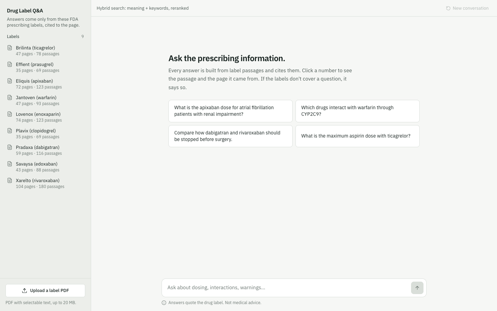
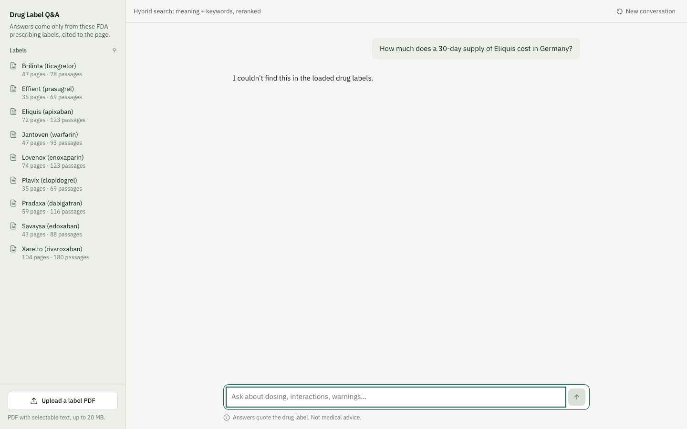

# Drug Label Q&A

Ask questions about FDA prescribing labels and get answers that cite the label page they came from.
Seeded with 9 anticoagulant and antiplatelet labels from DailyMed; you can upload more PDFs when uploads are on (`ALLOW_UPLOADS=true`, already set in `.env.example`).

No API keys at hand? The video and screenshots below show the full flow.

[](docs/demo.mp4)
*24-second demo · [full video (mp4)](docs/demo.mp4)*

## Quick start

Requirements: Docker. An Anthropic API key. A Voyage AI key is optional.

```bash
cp .env.example .env    # set ANTHROPIC_API_KEY, optionally VOYAGE_API_KEY
docker compose up --build
```

Open http://localhost:3000. If port 3000 is taken: `APP_PORT=3100 docker compose up --build`.

Compose first runs a one-off `release` step (migrations, then the seed labels with precomputed embeddings, so no Voyage calls), then starts the app. Ask "Which labels are loaded?" to see what is in the library.
Without `VOYAGE_API_KEY` the app runs keyword search only and shows a banner.

Local development (Node 24.22.3 from `.nvmrc`, pnpm):

```bash
docker compose up -d db
pnpm install
pnpm release           # migrate + seed
pnpm dev
```

| Command | What it does |
|---|---|
| `pnpm test` | Unit tests (chunker, RRF, citation and quote check, prompt escaping, PDF highlight, not-found rule, chat history, owner cookie) and route tests for chat and upload with a mock model |
| `pnpm eval` | Retrieval ablation + judged end-to-end answers + judge controls, writes `evals/results.md` |
| `pnpm release` | Migrate and seed under a database lock (what the compose `release` service runs) |
| `pnpm fetch-labels` | Downloads the pinned label PDFs from DailyMed |
| `pnpm build-seed` | Re-parses, chunks and embeds the seed labels into `data/seed/vectors.json` |

## Architecture



One Next.js app. `lib/rag/*` holds the pipeline as small functions (`pdf`, `chunk`, `embed`, `search`, `rrf`, `retrieve`, `prompt`, `citations`, `ingest`); the route handlers in `app/api/*` and the scripts in `scripts/*` call the same functions, so the eval runs the exact code the chat runs.

| Path | Role |
|---|---|
| `app/api/chat/route.ts` | Validates input, loads history, retrieves, streams the answer, writes `messages` + `traces` |
| `app/api/documents/*` | List, upload (PDF only, 20 MB), serve PDF bytes |
| `lib/rag/` | Parsing, chunking, embeddings, hybrid search, rerank, prompt, citation check |
| `lib/db/schema.ts` | `documents` (PDF as bytea), `chunks` (vector(1024) HNSW + generated tsvector GIN), `messages`, `traces` |
| `components/` | Chat, citation chips, source panel, react-pdf viewer |
| `evals/` | Golden set and latest results |

## Docs

| Doc | What is in it |
|---|---|
| [RAG approach and decisions](docs/rag-approach.md) | Use case, chunking, embeddings, vector store, retrieval, LLM, prompt and context, guardrails, evals, observability |
| [Key technical decisions](docs/technical-decisions.md) | App shape, Docker image, release step, storage, seed data |
| [Productionizing on AWS (or GCP / Azure)](docs/production.md) | Hosting, database, ingest, auth, observability, pharma specifics |
| [Engineering standards](docs/engineering-standards.md) | Standards followed and skipped |
| [How I used AI tools](docs/ai-tools.md) | Workflow, checks, what the AI got wrong, do's and don'ts |
| [What I'd do next](docs/next-steps.md) | Next steps and known limits |

## Screenshots

| Start | Cited answer |
|---|---|
|  |  |
| **Source panel with the cited page** | **Out-of-scope question** |
|  |  |

## Data source

Label PDFs: National Library of Medicine, DailyMed. Versions and set ids in `data/seed/SOURCES.md`.
